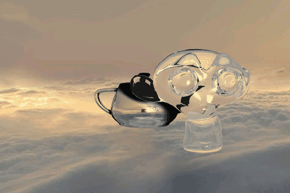

# RVRE · Ray tracer en C++ sobre un motor gráfico multi-backend

**Núcleo de iluminación de un ray tracer por CPU en C++: iluminación difusa y especular, sombras suaves, reflexión recursiva y refracción, dentro de un motor gráfico con backends de OpenGL, Vulkan y ray tracing por software.**

Es el proyecto final de la asignatura RVRE del máster. He implementado el núcleo de iluminación de un **ray tracer por CPU** dentro de un motor gráfico en C++. El motor se proporcionó como plantilla en la asignatura y puede renderizar la misma escena con varios backends: OpenGL, Vulkan y ray tracing por software con SDL.

## Enlaces

- 💻 **Implementación del ray tracer:** [`RayTracerImplementar.cpp`](APIS_2024-VK-RTSDL_plantilla/RayTracerImplementar.cpp)
- 🎞️ **Animación renderizada:** [`render_animado.gif`](docs/img/render_animado.gif)

## Mi aportación

Mi parte es el cálculo del color de cada rayo. Todo mi trabajo está en [`RayTracerImplementar.cpp`](APIS_2024-VK-RTSDL_plantilla/RayTracerImplementar.cpp). El resto del motor (`mapi/`) es la plantilla de la asignatura.

| Parte | Qué hace | Técnica |
|---|---|---|
| **Iluminación** | Calcula la luz que recibe cada punto según el tipo de emisor | Lambert (difusa) + Phong (especular) |
| **Sombras suaves** | Genera penumbra en los bordes de las sombras | Muestreo de una rejilla sobre el área de la luz |
| **Reflexión** | Refleja el entorno en los materiales pulidos | Rayos recursivos con `glm::reflect` |
| **Refracción** | Simula materiales transparentes como el cristal | Ley de Snell con `glm::refract` y reflexión total interna |

## Detalle de la implementación

### Iluminación (`computeLambertLight`)

- Cálculo del vector de luz según el tipo de emisor: dirección fija en las luces **direccionales** y vector normalizado hacia la luz en las **puntuales**.
- **Componente difusa (Lambert):** `pdf · kd · I · max(N·L, 0)`.
- **Componente especular (Phong):** `ks · I · max(V·R, 0)^shininess`.
- Suma de la luz ambiente y multiplicación por el color del emisor.

### Sombras suaves (`computeColorLight`)

En lugar de sombras duras (un único rayo de visibilidad hacia la luz), muestreo una **rejilla de puntos sobre el área de la luz**. Para cada punto compruebo si es visible desde el punto de colisión con `isVisible`. El factor de sombra es el porcentaje de puntos visibles, lo que da una **penumbra** en los bordes de la sombra.

### Reflexión

- Si el material es reflectante y quedan rebotes, genero un rayo reflejado con `glm::reflect`.
- Desplazo el origen 0,001 unidades a lo largo de la normal para evitar que el rayo vuelva a chocar con la misma superficie (*shadow acne*).
- Lo trazo de forma **recursiva** con `traceRay`.
- Mezclo el color reflejado con el del objeto en proporción al **pulido del material** (`shininess / 100`): cuanto más pulido, más espejo.
- En el primer rebote recupero el **brillo especular**, que se pierde al mezclar colores.

### Refracción

- Rayo refractado con `glm::refract` y la **ley de Snell**. El coeficiente depende de si el rayo **entra** (`1 / n`) o **sale** (`n / 1`) del objeto.
- Al salir, invierto la normal.
- Detecto la **reflexión total interna**: cuando no hay dirección refractada, el rayo se refleja.
- Mantengo el estado *inside* del rayo en cada rebote, para que funcione con objetos cerrados como Suzanne de cristal.
- Mezclo el color refractado con el del objeto y añado el brillo especular en el primer impacto.

## Escenas de demostración

`demos.cpp` define varias escenas. La que se ejecuta por defecto en `APIS3D_2024.cpp` es `skybox1RT()`:

- tetera **metálica** (reflexión)
- Suzanne de **cristal** (refracción)
- cubo con **normal map**
- skybox

Se renderiza a 720 × 480 con antialiasing, reflexión y refracción activados.

El render escribe cada fotograma en un archivo `.ppm`. La animación está hecha con los 72 fotogramas generados mientras se mueve la cámara:

Otras escenas disponibles en `demos.cpp`:

- **Ray tracing:** Cornell box con esferas de metal y cristal, con una tetera de cristal y con un conejo de cristal (`cornellBox1/2/3`).
- **OpenGL:** ciudad asiática, shadow mapping, sistema de partículas, animación esquelética.
- **Vulkan:** demo básica.

## El motor

El motor (`mapi/`) abstrae el backend gráfico detrás de una `FactoryEngine`. El backend se elige al arrancar con `System::initSystem(backend_e::...)`:

| Backend | Tecnología |
|---|---|
| `GL4` | OpenGL 4 + GLFW |
| `VK` | Vulkan + shaderc/glslang |
| `RT_SDL` | Ray tracing por CPU, mostrado con SDL2 y paralelizado con **OpenMP** |

El ray tracer lanza los rayos de cada píxel en paralelo con `#pragma omp parallel for`. Con antialiasing activado renderiza al doble de resolución, y acelera las colisiones con cajas envolventes (AABB) por malla.

## Alcance

La práctica incluía también una parte opcional de **iluminación global por mapeo de fotones (photon mapping) y cáusticas** (`tracePhoton` y el bloque *Global light*), además de la **atenuación lineal** de la luz. Esas partes quedan como trabajo futuro, por eso las escenas Cornell box no tienen iluminación indirecta.

## Lo que he aprendido

- Cómo funciona un ray tracer de Whitted: rayos primarios, rayos de sombra, y rebotes recursivos de reflexión y refracción con un límite de profundidad.
- Modelos de iluminación locales (Lambert y Phong) aplicados punto a punto, fuera del pipeline de shaders.
- Aspectos físicos de la refracción: índices de refracción, entrada y salida de objetos, reflexión total interna.
- Problemas prácticos de precisión numérica (*shadow acne*, autointersecciones) y el coste de calidad frente a rendimiento de las sombras suaves y el antialiasing.

## Tecnologías

- **C++**
- **GLM** para el álgebra vectorial (`reflect`, `refract`, productos escalares)
- **SDL2** para mostrar el render del ray tracer
- **OpenMP** para paralelizar el trazado de rayos por píxel
- **OpenGL 4 + GLFW** y **Vulkan** como backends del motor

## Contenido del repositorio

- `APIS_2024-VK-RTSDL_plantilla/RayTracerImplementar.cpp`: implementación del ray tracer (mi trabajo).
- `APIS_2024-VK-RTSDL_plantilla/demos.cpp`, `APIS3D_2024.cpp`: escenas de demostración y punto de entrada.
- `APIS_2024-VK-RTSDL_plantilla/mapi/`: motor gráfico (plantilla de la asignatura).
- `APIS_2024-VK-RTSDL_plantilla/data/`: mallas, texturas, skyboxes, shaders y configuración de pipelines.
- `APIS_2024-VK-RTSDL_plantilla/out*.ppm`: fotogramas renderizados.
- [`docs/img/`](docs/img): imágenes de este README.

## Autora

Olaia Picabea Sainz
